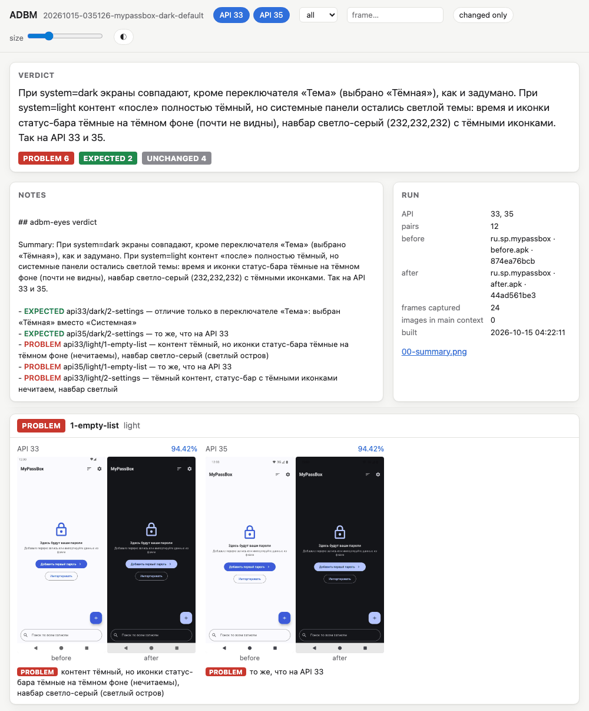

# ADBM — Android Debug Bridge Matrix

[Русский](README.ru.md)

ADBM is a skill for AI agents and a CLI for Android. [Codex](https://developers.openai.com/codex/skills) and
[Claude Code](https://code.claude.com/docs/en/skills) use the same skill. Other agents can follow its instructions
and call the CLI. It reads screens, taps elements and checks what happened through
[adb](https://developer.android.com/tools/adb) on a phone or [emulator](https://developer.android.com/studio/run/emulator).

## Why

The agent checks the app, and you only look at the result.

- **Deterministic.** Python scripts work with the device, not a model looking at a screenshot.
  `adbm tap "Settings" --expect "Theme"` finds the element in the UI tree, waits for it while the screen loads,
  taps it and checks that the right screen opened.
  `adbm wait` and `adbm assert` answer with an exit code, `adbm diff` computes changes pixel by pixel.
  The same command on the same screen gives the same result, so a check can be repeated.
- **More reliable and faster.** The agent does not take a screenshot before every step to decide where to tap
  and what happened. It calls a command and reads a short answer: what appeared, what went away, whether it worked.
  So there are fewer steps and fewer mistakes.
- **A model where a script cannot help.** A script cannot tell whether a change is expected or the layout broke.
  A subagent decides that: it looks only at the frames that changed and writes the verdict.
- **Fewer tokens.** This follows from the deterministic commands: the agent reads lines of text, not images.
- **Fully automated.** The agent boots the emulators, installs the builds, runs the scenario and compares the frames.
- **Easier for you to check.** You open one board and see only what changed, with a verdict
  for each frame. In a minute you know whether everything is fine.

## What it does

- **Device control.** The agent launches and stops the app, navigates the screen,
  types text (Cyrillic included), runs several actions in one call, reads [logcat](https://developer.android.com/tools/logcat) and the crash history,
  grants permissions, fakes the GPS location, reads and writes the clipboard, copies files.
- **Several API levels at once.** The agent boots emulators for the Android versions you need,
  installs the APK and runs a [Maestro flow](https://docs.maestro.dev) on all API levels in parallel, with a theme and navigation matrix.
- **Screenshots and video.** The agent saves frames to the run folder, takes a downscaled frame or a crop, records video.
  `adbm board` puts the frames on an HTML page: screens of one build to look at, no comparison needed.
- **Change checks.** When a change needs checking — a fix, a bug — the agent installs "before" and "after" builds and computes a pixel diff.
  Then `adbm` builds an HTML board and a "before | after" PNG contact sheet, and a [subagent](skill/reference/visual-check.md#the-adbm-eyes-subagent) writes the verdict.

Whatever can be computed, `adbm` computes. A model looks at a picture only when nothing else helps.
The main agent skips full-size frames. A 1080×2400 image costs a model ~3350 tokens:

- **the agent navigates by text** — `adbm ui` shrinks the UI tree 10–20×, `adbm tap "Close"`;
- **"did it change" is computed in Python** — `adbm diff` reports percent and area, and element shifts for frames from `adbm shot`;
- **a subagent looks at the images** on a cheap model and returns up to 10 lines;
- **when a picture is unavoidable** — `adbm look` returns a 540 px frame (~860 tokens) or a crop.

`adbm status` shows what this cost. Without arguments it lists every run of the project: calls, tokens `adbm` put
into the agent's context and tokens saved. `adbm status <run>` shows one run with calls and tokens per command.

```
  run                        when               calls    tokens  images      saved
  20261015-101210-insets     2026-10-15 10:12      64     2,310       1     71,950
* 20261016-155635-sheet      2026-10-16 15:56      96     3,760       1    248,423
  total                                           160     6,070       2    320,373
```

`saved` is a rough estimate: every `ui` and `tap` counts as a 1080×2400 screenshot it replaced. `adbm` counts only
its own output, not files the agent read or its own text. Counters live in each run's `stats.json`, so deleting old
runs (`adbm clean`) removes them from the total. Details: [docs/commands.md](docs/commands.md#measuring-tokens).

## How it works

Without a change to check, the same goes shorter: one build, `adbm run` or `adbm shot`, `adbm board` with the screens.

1. **Builds.** `adbm install` installs the "before" build on all emulators at once, later the "after" build.
2. **Scenario.** `adbm run` runs one Maestro flow on all API levels in parallel, in every cell of the theme and navigation matrix.
3. **Diff.** `adbm diff` compares "before | after" pairs pixel by pixel. Nobody looks at unchanged pairs after this.
4. **Verdict.** The `adbm-eyes` subagent looks at the changed pairs and writes EXPECTED, PROBLEM or REVIEW.
5. **Board.** `adbm board` builds an HTML page with the summary, verdicts and frame pairs.



This is the board of a real run: the app's default theme changed, and the check found an unreadable
status bar. A step-by-step walkthrough with diff lines and crops is in [docs/example.md](docs/example.md).

## Built on

ADBM does not replace these tools: it builds deterministic commands for the agent out of them.

| Tool | License | What it does in ADBM |
|---|---|---|
| [Maestro](https://github.com/mobile-dev-inc/Maestro) — a UI testing framework by mobile.dev | Apache 2.0, open source | runs scenarios: `adbm run` runs a flow on all API levels, `adbm save-flow` writes a flow from a manual session, `adbm type` types non-ASCII text through it when mobilecli is not installed. Flow syntax: [Maestro docs](https://docs.maestro.dev) |
| [Android SDK](https://developer.android.com/tools): adb, emulator, sdkmanager, avdmanager | Google's [Android SDK License Agreement](https://developer.android.com/studio/terms); open-source parts of the SDK keep their own licenses | device connection, emulators, image downloads |
| [Pillow](https://python-pillow.github.io) | MIT-CMU, open source | pixel diff, crops, contact sheet |
| [FFmpeg](https://ffmpeg.org) | LGPL 2.1+, open source; a build with `--enable-gpl` is GPL 2+ | frames from video for `adbm record` |
| [Android CLI](https://developer.android.com/tools/agents/android-cli), optional | a closed Google binary, no published license; collects usage data, `adbm` turns that off with `--no-metrics` | needed for screens without a UI tree: games, Canvas, WebView without accessibility. `adbm annotate` draws numbers of the found elements on a frame, `adbm tap '#7'` taps by number. Without Android CLI everything else works, and on such a screen the agent taps by coordinates from an `adbm look` frame. When the agent meets such a screen, it offers to install Android CLI and installs it only after you agree: `adbm setup --android-cli --yes` |
| [mobilecli](https://github.com/mobile-next/mobilecli) by Mobile Next, optional | [FSL-1.1-ALv2](https://github.com/mobile-next/mobilecli/blob/main/LICENSE): the source is open, but it is not an OSI license — it forbids a competing commercial product built on its code; each release becomes Apache 2.0 two years later. `adbm` does not ship it, it calls the copy you installed. No telemetry found in its code (checked 23.10.2026, version 1.0.21) | the device clipboard: `adbm clipboard` reads and writes it, `adbm type` pastes non-ASCII text through it: 2–3 s on an emulator and ~6 s on a phone over Wi-Fi, against ~8 s and ~17 s through Maestro. Without mobilecli everything else works. It is installed only after you agree: `adbm setup --mobilecli --yes` (npm) |

## Install and try ADBM

For basic device control, you need Python 3.9+, Android SDK Platform-Tools, and a running emulator
or a phone with USB debugging enabled. Add Pillow for `look` and image comparison, and Maestro for flows.
[Set up the SDK and emulator](skill/reference/setup.md#requirements) · [Connect a phone over Wi-Fi](skill/reference/connection.md).

Tested on macOS. On Linux the emulator needs `/dev/kvm`. Windows is not supported. WSL is untested.

### Codex

In a terminal:

```bash
git clone https://github.com/StasPotapov/adbm.git "$HOME/adbm"
mkdir -p "$HOME/.agents/skills"
adbm_skill="$HOME/.agents/skills/adbm"
[ -e "$adbm_skill" ] || [ -L "$adbm_skill" ] || ln -s "$HOME/adbm/skill" "$adbm_skill"
```

If the skill is already installed, check where the existing link points before changing it.
Open your Android project in a new Codex session and ask: “Use $adbm. Check the environment,
list connected devices and read the emulator screen.” This does not need the Claude Code hook.

### Claude Code

In Claude Code:

```text
/plugin marketplace add StasPotapov/sp-tools
/plugin install adbm@sp-tools
```

Ask Claude Code: “Use /adbm:adbm. Check the environment, list connected devices and read the emulator screen.”
The plugin adds the skill, the `adbm:adbm-eyes` agent and a Claude Code hook. It does not add the CLI to your `PATH`.
To update, run `/plugin marketplace update sp-tools`, then `claude plugin update adbm@sp-tools` in a terminal.
The marketplace can lag behind the repository: its v0.3.2 plugin lacks Wi-Fi pairing.
To use the same revision as Codex, clone the repository as above and link its skill instead of installing the plugin:

```bash
mkdir -p "$HOME/.claude/skills"
adbm_skill="$HOME/.claude/skills/adbm"
[ -e "$adbm_skill" ] || [ -L "$adbm_skill" ] || ln -s "$HOME/adbm/skill" "$adbm_skill"
```

In a fresh session use `/adbm`. Pick one Claude Code installation method.
See [manual hook and agent setup](docs/configuration.md#guard-hook) if you want those optional components.

### Other agents and the terminal

Keep the whole [`skill/`](skill/) directory: it contains the instructions, CLI and resources. Give your
agent the path to `SKILL.md` or use its skill discovery folder. It needs a local shell, file access
and the Android SDK. An independent visual verdict also needs a subagent and image access.
[How to launch the visual subagent](skill/reference/visual-check.md#the-adbm-eyes-subagent).

From a terminal in your Android project (assuming ADBM is cloned into `$HOME/adbm`):

```bash
ADBM="$HOME/adbm/skill/bin/adbm"
"$ADBM" --version
"$ADBM" doctor
"$ADBM" devices
"$ADBM" ui                       # one connected emulator
# "$ADBM" ui --serial SERIAL     # for a phone or to pick an exact device
```

On a phone-only setup, `doctor` can report missing emulator or image tools. If it finds `adb`, continue with
`devices` and `ui --serial SERIAL`. No devices? Start an existing emulator in Android Studio, or run
`"$ADBM" devices --start 33` if you have an API 33 AVD.
For image commands, install Pillow for the Python that runs ADBM: `brew install pillow` on Homebrew,
`sudo apt install python3-pil` on Debian/Ubuntu, or `python3 -m pip install Pillow` in your Python environment.
[Try ADBM on Android Settings](skill/reference/setup.md#check-that-it-works) without an app APK.

## Common commands

| Task | Command |
|---|---|
| what is on the screen | `adbm ui` |
| tap and wait for the next screen | `adbm tap "Settings" --expect "Theme"` |
| fake GPS | `adbm location 55.7558,37.6173`, `adbm location clear` |
| several actions in one call | `adbm batch 'tap Email' 'type a@b.c' 'tap Next' --ui` |
| boot the project's emulators | `adbm devices --start` |
| install a build | `adbm install app.apk --as before` |
| run a scenario over a matrix | `adbm run .adbm/flows/x.yaml --matrix theme=light,dark` |
| compare and show | `adbm diff`, then `adbm board --open` |
| app logs, crashes | `adbm log`, `adbm log --crash`, `adbm crashes` |
| tokens spent and saved | `adbm status`, `adbm status <run>` |
| check the environment | `adbm doctor` |

## Documentation

| File | What is in it |
|---|---|
| [docs/example.md](docs/example.md) | a real run step by step: commands, diff lines, crops, contact sheet, result |
| [docs/configuration.md](docs/configuration.md) | `config.ini`: API levels, subagent model and effort; the guard hook and the `adbm-eyes` agent |
| [docs/commands.md](docs/commands.md) | all commands, the run folder layout, measuring a session's tokens |
| [docs/alternatives.md](docs/alternatives.md) | similar tools: what they do and how ADBM differs |
| [skill/SKILL.md](skill/SKILL.md), [skill/reference/](skill/reference/) | instructions for the agent |

## Tests

```bash
python3 -m unittest discover tests
```

No device is needed: the tests cover the UI tree parser, the matrix, the diff, verdicts, `save-flow`, settings,
the guard hook and the session measurement on fixtures from a real run. Without Pillow the image tests are skipped.

## License

MIT

## Wi-Fi phones without Android Studio

`adbm pair --open` generates a QR, waits for the phone, pairs and connects it.
Use `adbm pair --ip <phone-Wi-Fi-IP> --open` when mDNS is unavailable, and `adbm connect` next time.
QR generation needs qrencode or Python qrcode[pil]. See [connection instructions](skill/reference/connection.md) for setup and troubleshooting.
