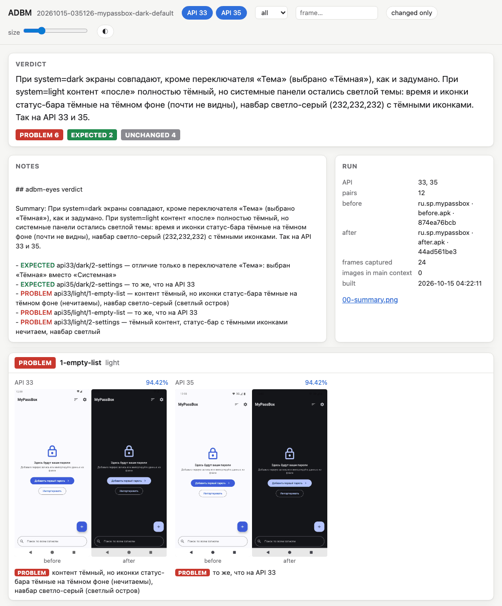

# ADBM — Android Debug Bridge Matrix

[English](README.md)

ADBM — скилл для AI-агентов и CLI для Android. [Codex](https://developers.openai.com/codex/skills) и
[Claude Code](https://code.claude.com/docs/en/skills) используют один скилл. Другие агенты могут использовать
его инструкции и вызывать CLI. Команды читают экран, нажимают на элементы и проверяют результат через
[adb](https://developer.android.com/tools/adb) на телефоне или [эмуляторе](https://developer.android.com/studio/run/emulator).

## Зачем

Приложение проверяет агент, а ты только смотришь итог.

- **Детерминированно.** С устройством работают Python-скрипты, а не модель по скриншоту.
  `adbm tap "Настройки" --expect "Тема"` сам находит элемент в дереве UI, ждёт его, если экран ещё грузится,
  нажимает и проверяет, что открылся нужный экран.
  `adbm wait` и `adbm assert` отвечают кодом выхода, `adbm diff` считает изменения по пикселям.
  Та же команда на том же экране даёт тот же результат, поэтому проверку можно повторить.
- **Надёжнее и быстрее.** Агент не снимает экран перед каждым шагом и не решает, куда нажать и что произошло.
  Он вызывает команду и читает короткий ответ: что появилось, что пропало, получилось ли.
  Поэтому шагов меньше и ошибок меньше.
- **Модель — там, где скрипт не справится.** Скрипт не скажет, ожидаемо ли изменение и не сломалась ли вёрстка.
  Это решает субагент: он смотрит только кадры, которые изменились, и пишет вердикт.
- **Меньше токенов.** Это следствие детерминированных команд: агент читает строки текста, а не картинки.
- **Всё автоматически.** Агент сам поднимает эмуляторы, ставит сборки, прогоняет сценарий и сравнивает кадры.
- **Тебе проще проверить.** Ты открываешь один борд и видишь только то, что изменилось, с вердиктом
  к каждому кадру. За минуту ты понимаешь, всё ли в порядке.

## Что умеет

- **Управление устройством.** Агент запускает и останавливает приложение, ходит по экрану,
  вводит текст (в том числе кириллицу), выполняет несколько действий за один вызов, читает [logcat](https://developer.android.com/tools/logcat)
  и историю падений, выдаёт разрешения, подменяет GPS, читает и пишет буфер обмена, копирует файлы.
- **Несколько API сразу.** Агент поднимает эмуляторы нужных версий Android, ставит APK
  и прогоняет [Maestro flow](https://docs.maestro.dev) на всех API параллельно, с матрицей тем и навигации.
- **Скриншоты и видео.** Агент снимает кадры в папку прогона, берёт уменьшенный кадр или фрагмент, пишет видео.
  `adbm board` выкладывает кадры на HTML-страницу: экраны одной сборки, чтобы посмотреть, без сравнения.
- **Проверка изменений.** Когда нужно проверить правку — исправление, баг, — агент ставит сборки «до» и «после» и считает пиксельный дифф.
  Затем `adbm` собирает HTML-борд и PNG-коллаж «до | после», а [субагент](skill/reference/visual-check.md#the-adbm-eyes-subagent) пишет вердикт.

Всё, что можно посчитать, считает `adbm`. Модель смотрит на картинку, только когда без неё никак.
Основной агент пропускает полноразмерные кадры. Кадр 1080×2400 стоит модели около 3350 токенов:

- **по экрану агент ходит по тексту** — `adbm ui` сжимает дерево UI в 10–20 раз, `adbm tap "Закрыть"`;
- **«изменилось ли» считает Python** — `adbm diff` даёт процент и область, для кадров из `adbm shot` — ещё и сдвиги элементов;
- **кадры смотрит субагент** на дешёвой модели и возвращает до 10 строк;
- **если без картинки никак** — `adbm look` отдаёт кадр 540 px (~860 токенов) или фрагмент.

Сколько это стоило, показывает `adbm status`. Без аргументов он выводит все прогоны проекта: вызовы, токены,
которые `adbm` положил в контекст агента, и сэкономленные токены. `adbm status <прогон>` показывает один прогон
с вызовами и токенами по командам.

```
  run                        when               calls    tokens  images      saved
  20261015-101210-insets     2026-10-15 10:12      64     2,310       1     71,950
* 20261016-155635-sheet      2026-10-16 15:56      96     3,760       1    248,423
  total                                           160     6,070       2    320,373
```

`saved` — грубая оценка: каждый `ui` и `tap` считается скриншотом 1080×2400, который он заменил. `adbm` считает
только свой вывод. Файлы, которые прочитал агент, и его собственный текст в счёт не входят. Счётчики лежат
в `stats.json` каждого прогона, поэтому удалённые прогоны (`adbm clean`) выпадают из итога.
Подробно — [docs/commands.ru.md](docs/commands.ru.md#замер-токенов).

## Как это работает

Без правки, которую надо проверить, путь короче: одна сборка, `adbm run` или `adbm shot`, `adbm board` с экранами.

1. **Сборки.** `adbm install` ставит сборку «до» на все эмуляторы сразу, позже — сборку «после».
2. **Сценарий.** `adbm run` прогоняет один Maestro flow на всех API параллельно, в каждой ячейке матрицы тем и навигации.
3. **Дифф.** `adbm diff` сравнивает пары «до | после» по пикселям. Неизменённые пары дальше никто не смотрит.
4. **Вердикт.** Субагент `adbm-eyes` смотрит изменённые пары и пишет EXPECTED, PROBLEM или REVIEW.
5. **Борд.** `adbm board` собирает HTML-страницу с итогом, вердиктами и парами кадров.



Это борд реального прогона: в приложении сменили тему по умолчанию, и проверка нашла нечитаемый
статус-бар. Разбор по шагам, со строками диффа и кропами, — в [docs/example.ru.md](docs/example.ru.md).

## На чём построен

ADBM не заменяет эти инструменты, а собирает из них детерминированные команды для агента.

| Инструмент | Лицензия | Что делает в ADBM |
|---|---|---|
| [Maestro](https://github.com/mobile-dev-inc/Maestro) — фреймворк UI-тестов от mobile.dev | Apache 2.0, открытый | выполняет сценарии: `adbm run` гоняет flow на всех API, `adbm save-flow` пишет flow из ручной сессии, `adbm type` вводит через него не-ASCII текст, если mobilecli не установлен. Синтаксис flow — [документация Maestro](https://docs.maestro.dev) |
| [Android SDK](https://developer.android.com/tools): adb, emulator, sdkmanager, avdmanager | [Android SDK License Agreement](https://developer.android.com/studio/terms) от Google; открытые части SDK — под своими лицензиями | связь с устройством, эмуляторы, скачивание образов |
| [Pillow](https://python-pillow.github.io) | MIT-CMU, открытый | пиксельный дифф, кропы, коллаж |
| [FFmpeg](https://ffmpeg.org) | LGPL 2.1+, открытый; сборка с `--enable-gpl` — GPL 2+ | кадры из видео для `adbm record` |
| [Android CLI](https://developer.android.com/tools/agents/android-cli), необязательный | закрытый бинарник Google, лицензия не опубликована; собирает данные об использовании, `adbm` выключает это флагом `--no-metrics` | нужен для экранов без дерева UI: игры, Canvas, WebView без доступности. `adbm annotate` рисует на кадре номера найденных элементов, `adbm tap '#7'` нажимает по номеру. Без Android CLI всё остальное работает, а на таком экране агент нажимает по координатам с кадра `adbm look`. Если агент встретит такой экран, он сам предложит поставить Android CLI и поставит только после твоего согласия: `adbm setup --android-cli --yes` |
| [mobilecli](https://github.com/mobile-next/mobilecli) от Mobile Next, необязательный | [FSL-1.1-ALv2](https://github.com/mobile-next/mobilecli/blob/main/LICENSE): исходники открыты, но это не OSI-лицензия — она запрещает конкурирующий коммерческий продукт на его коде; каждый выпуск через два года переходит на Apache 2.0. `adbm` его не поставляет, а вызывает установленную тобой копию. Телеметрии в его коде не нашлось (проверено 23.10.2026, версия 1.0.21) | буфер обмена устройства: `adbm clipboard` читает и пишет его, `adbm type` вставляет через него не-ASCII текст: 2–3 с на эмуляторе и ~6 с на телефоне по Wi-Fi против ~8 с и ~17 с через Maestro. Без mobilecli всё остальное работает. Ставится только после твоего согласия: `adbm setup --mobilecli --yes` (npm) |

## Установка и первый запуск

Для первых команд нужны Python 3.9+, Android SDK Platform-Tools и работающий эмулятор или телефон
с отладкой USB. Для `look` и сравнения кадров нужен Pillow. Для сценариев нужен Maestro.
[Настройка SDK и эмулятора](skill/reference/setup.md#requirements) · [Телефон по Wi-Fi](skill/reference/connection.md).

Мы проверили macOS. Для эмулятора на Linux нужен `/dev/kvm`. Windows не поддерживается. WSL не проверяли.

### Codex

В терминале:

```bash
git clone https://github.com/StasPotapov/adbm.git "$HOME/adbm"
mkdir -p "$HOME/.agents/skills"
adbm_skill="$HOME/.agents/skills/adbm"
[ -e "$adbm_skill" ] || [ -L "$adbm_skill" ] || ln -s "$HOME/adbm/skill" "$adbm_skill"
```

Если скилл уже установлен, проверь, куда ведёт ссылка, прежде чем менять её.
Открой проект Android в новой сессии Codex и напиши: «Используй $adbm. Проверь окружение,
покажи подключённые устройства и прочитай экран эмулятора». Хук Claude Code для этого не нужен.

### Claude Code

В Claude Code:

```text
/plugin marketplace add StasPotapov/sp-tools
/plugin install adbm@sp-tools
```

Попроси Claude Code: «Используй /adbm:adbm. Проверь окружение, покажи подключённые устройства и прочитай экран эмулятора».
Плагин добавляет скилл, агента `adbm:adbm-eyes` и хук Claude Code. Он не добавляет CLI в `PATH`.
Для обновления выполни `/plugin marketplace update sp-tools`, затем `claude plugin update adbm@sp-tools` в терминале.
Каталог может отставать от репозитория. Например, в плагине v0.3.2 нет подключения по Wi-Fi.
Чтобы взять ту же версию, что и для Codex, клонируй репозиторий как выше и добавь ссылку вместо плагина:

```bash
mkdir -p "$HOME/.claude/skills"
adbm_skill="$HOME/.claude/skills/adbm"
[ -e "$adbm_skill" ] || [ -L "$adbm_skill" ] || ln -s "$HOME/adbm/skill" "$adbm_skill"
```

В новой сессии вызови `/adbm`. Выбери один способ установки для Claude Code.
[Ручная установка хука и агента](docs/configuration.ru.md#хук-ограждение) нужна только при желании их подключить.

### Другие агенты и терминал

Возьми весь каталог [`skill/`](skill/): внутри инструкции, CLI и ресурсы. Укажи агенту путь к
`SKILL.md` или добавь каталог в путь поиска скиллов. Для работы нужны доступ к локальному терминалу,
файлам и Android SDK. Для независимого вердикта нужны субагент и просмотр изображений.
[Как запустить субагента](skill/reference/visual-check.md#the-adbm-eyes-subagent).

Из терминала, в каталоге своего Android-проекта (если клон ADBM лежит в `$HOME/adbm`):

```bash
ADBM="$HOME/adbm/skill/bin/adbm"
"$ADBM" --version
"$ADBM" doctor
"$ADBM" devices
"$ADBM" ui                       # один подключённый эмулятор
# "$ADBM" ui --serial SERIAL     # для телефона или выбора конкретного устройства
```

Если работаешь только с телефоном, `doctor` может сообщить об отсутствии эмулятора и инструментов для кадров.
Если `adb` найден, продолжи с `devices` и `ui --serial SERIAL`.
Нет устройств? Запусти готовый эмулятор в Android Studio или через `"$ADBM" devices --start 33`
(если создан AVD с API 33). Для кадров поставь Pillow в тот Python, который запускает ADBM:
на Homebrew — `brew install pillow`, на Debian/Ubuntu — `sudo apt install python3-pil`,
для другого Python — `python3 -m pip install Pillow` в подходящем окружении.
[Проверка на системных настройках Android](skill/reference/setup.md#check-that-it-works) не требует APK проекта.

## Частые команды

| Задача | Команда |
|---|---|
| что на экране | `adbm ui` |
| нажать и дождаться следующего экрана | `adbm tap "Настройки" --expect "Тема"` |
| подменить GPS | `adbm location 55.7558,37.6173`, `adbm location clear` |
| несколько действий за один вызов | `adbm batch 'tap Email' 'type a@b.c' 'tap Далее' --ui` |
| поднять эмуляторы проекта | `adbm devices --start` |
| поставить сборку | `adbm install app.apk --as before` |
| прогнать сценарий по матрице | `adbm run .adbm/flows/x.yaml --matrix theme=light,dark` |
| сравнить и показать | `adbm diff`, затем `adbm board --open` |
| логи приложения, падения | `adbm log`, `adbm log --crash`, `adbm crashes` |
| сколько токенов потрачено и сэкономлено | `adbm status`, `adbm status <прогон>` |
| проверить окружение | `adbm doctor` |

## Документация

| Файл | Что там |
|---|---|
| [docs/example.ru.md](docs/example.ru.md) | реальный прогон по шагам: команды, строки диффа, кропы, коллаж, итог |
| [docs/configuration.ru.md](docs/configuration.ru.md) | `config.ini`: уровни API, модель и effort субагента; хук-ограждение и агент `adbm-eyes` |
| [docs/commands.ru.md](docs/commands.ru.md) | все команды, раскладка папки прогона, замер токенов сессии |
| [docs/alternatives.ru.md](docs/alternatives.ru.md) | похожие инструменты: что они делают и чем ADBM от них отличается |
| [skill/SKILL.md](skill/SKILL.md), [skill/reference/](skill/reference/) | инструкции для агента, на английском |

## Тесты

```bash
python3 -m unittest discover tests
```

Устройство не нужно: тесты проверяют разбор дерева UI, матрицу, дифф, вердикты, `save-flow`, настройки,
хук-ограждение и замер сессии на фикстурах из реального прогона. Без Pillow тесты картинок пропускаются.

## Лицензия

MIT

## Телефон по Wi-Fi без Android Studio

`adbm pair --open` создаёт QR-код, ждёт сканирования, сопрягает и подключает телефон.
Если mDNS не работает: `adbm pair --ip <Wi-Fi-IP-телефона> --open`. В следующий раз — `adbm connect`.
Для QR нужен qrencode или Python qrcode[pil]. Настройка, VPN, порты и ошибки — в [инструкции подключения](skill/reference/connection.md).
