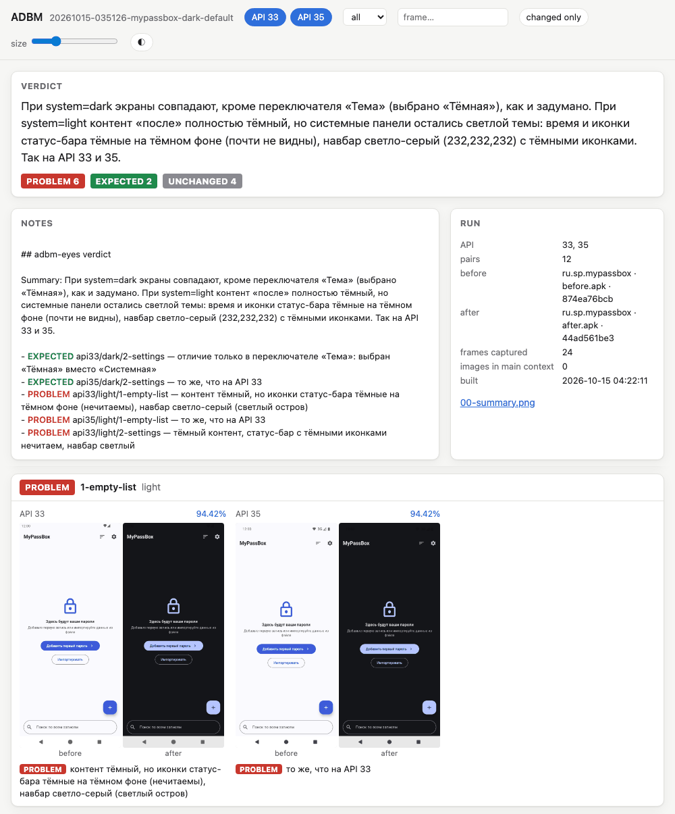

# ADBM — Android Debug Bridge Matrix

[English](README.md)

[Claude Code](https://code.claude.com/docs/en/overview) [skill](https://code.claude.com/docs/en/skills) и CLI `adbm`: агент работает с Android-устройством и [эмуляторами](https://developer.android.com/studio/run/emulator) через [adb](https://developer.android.com/tools/adb)
и тратит на это мало токенов. Агент вызывает команды `adbm` вместо сырого `adb`.

## Зачем

Приложение проверяет агент, а ты только смотришь итог.

- **Агенту проще.** Одна команда `adbm` заменяет цепочку вызовов `adb`. Агент экономит токены на каждом шаге:
  на навигации, на снимках экрана и на проверке. Поэтому он работает быстрее и дешевле.
- **Всё автоматически.** Агент сам поднимает эмуляторы, ставит сборки, прогоняет сценарий и сравнивает кадры.
- **Тебе проще проверить.** Ты открываешь один борд и видишь только то, что изменилось, с вердиктом
  к каждому кадру. За минуту ты понимаешь, всё ли в порядке.

## Что умеет

- **Управление устройством.** Агент запускает и останавливает приложение, ходит по экрану,
  вводит текст (в том числе кириллицу), читает [logcat](https://developer.android.com/tools/logcat), выдаёт разрешения, копирует файлы.
- **Несколько API сразу.** Агент поднимает эмуляторы нужных версий Android, ставит APK
  и прогоняет [Maestro flow](https://docs.maestro.dev) на всех API параллельно, с матрицей тем и навигации.
- **Скриншоты и видео.** Агент снимает кадры в папку прогона, берёт уменьшенный кадр или фрагмент, пишет видео.
- **Проверка изменений.** Агент ставит сборки «до» и «после» и считает пиксельный дифф.
  Затем `adbm` собирает HTML-борд и PNG-коллаж «до | после», а [субагент](https://code.claude.com/docs/en/sub-agents) пишет вердикт.

Кадр 1080×2400 стоит модели ~3350 токенов, поэтому картинки в контекст агента не идут:

- **по экрану агент ходит по тексту** — `adbm ui` сжимает дерево UI в 10–20 раз, `adbm tap "Закрыть"`;
- **«изменилось ли» считает Python** — `adbm diff` даёт процент и область, для кадров из `adbm shot` — ещё и сдвиги элементов;
- **кадры смотрит субагент** на дешёвой модели и возвращает до 10 строк;
- **если без картинки никак** — `adbm look` отдаёт кадр 540 px (~860 токенов) или фрагмент.

Сколько это стоило, показывает `adbm status`. Без аргументов он выводит все прогоны проекта: вызовы, токены,
которые `adbm` положил в контекст агента, и сэкономленные токены. `adbm status <прогон>` показывает один прогон
с вызовами и токенами по командам.

```
  run                        when               calls    tokens  images      saved
  20261015-101210-insets     2026-10-15 10:12      64     2,310       1     71,950
* 20261016-155635-sheet      2026-10-16 15:56      96     3,760       1    248,423
  total                                           160     6,070       2    320,373
```

`saved` — грубая оценка: каждый `ui` и `tap` считается скриншотом 1080×2400, который он заменил. `adbm` считает
только свой вывод. Файлы, которые прочитал агент, и его собственный текст в счёт не входят. Счётчики лежат
в `stats.json` каждого прогона, поэтому удалённые прогоны (`adbm clean`) выпадают из итога.
Подробно — [docs/commands.ru.md](docs/commands.ru.md#замер-токенов).

## Как это работает

1. **Сборки.** `adbm install` ставит сборку «до» на все эмуляторы сразу, позже — сборку «после».
2. **Сценарий.** `adbm run` прогоняет один Maestro flow на всех API параллельно, в каждой ячейке матрицы тем и навигации.
3. **Дифф.** `adbm diff` сравнивает пары «до | после» по пикселям. Неизменённые пары дальше никто не смотрит.
4. **Вердикт.** Субагент `adbm-eyes` смотрит изменённые пары и пишет EXPECTED, PROBLEM или REVIEW.
5. **Борд.** `adbm board` собирает HTML-страницу с итогом, вердиктами и парами кадров.



Это борд реального прогона: в приложении сменили тему по умолчанию, и проверка нашла нечитаемый
статус-бар. Разбор по шагам, со строками диффа и кропами, — в [docs/example.ru.md](docs/example.ru.md).

## На чём построен

ADBM не заменяет эти инструменты, а связывает их и экономит токены агента.

| Инструмент | Лицензия | Что делает в ADBM |
|---|---|---|
| [Maestro](https://github.com/mobile-dev-inc/Maestro) — фреймворк UI-тестов от mobile.dev | Apache 2.0, открытый | выполняет сценарии: `adbm run` гоняет flow на всех API, `adbm save-flow` пишет flow из ручной сессии, `adbm type` вводит через него не-ASCII текст, если mobilecli не установлен. Синтаксис flow — [документация Maestro](https://docs.maestro.dev) |
| [Android SDK](https://developer.android.com/tools): adb, emulator, sdkmanager, avdmanager | [Android SDK License Agreement](https://developer.android.com/studio/terms) от Google; открытые части SDK — под своими лицензиями | связь с устройством, эмуляторы, скачивание образов |
| [Pillow](https://python-pillow.github.io) | MIT-CMU, открытый | пиксельный дифф, кропы, коллаж |
| [FFmpeg](https://ffmpeg.org) | LGPL 2.1+, открытый; сборка с `--enable-gpl` — GPL 2+ | кадры из видео для `adbm record` |
| [Android CLI](https://developer.android.com/tools/agents/android-cli), необязательный | закрытый бинарник Google, лицензия не опубликована; собирает данные об использовании, `adbm` выключает это флагом `--no-metrics` | нужен для экранов без дерева UI: игры, Canvas, WebView без доступности. `adbm annotate` рисует на кадре номера найденных элементов, `adbm tap '#7'` нажимает по номеру. Без Android CLI всё остальное работает, а на таком экране агент нажимает по координатам с кадра `adbm look`. Если агент встретит такой экран, он сам предложит поставить Android CLI и поставит только после твоего согласия: `adbm setup --android-cli --yes` |
| [mobilecli](https://github.com/mobile-next/mobilecli) от Mobile Next, необязательный | [FSL-1.1-ALv2](https://github.com/mobile-next/mobilecli/blob/main/LICENSE): исходники открыты, но это не OSI-лицензия — она запрещает конкурирующий коммерческий продукт на его коде; каждый выпуск через два года переходит на Apache 2.0. `adbm` его не поставляет, а вызывает установленную тобой копию. Телеметрии в его коде не нашлось (проверено 23.10.2026, версия 1.0.21) | буфер обмена устройства: `adbm clipboard` читает и пишет его, `adbm type` вставляет через него не-ASCII текст: 2–3 с на эмуляторе и ~6 с на телефоне по Wi-Fi против ~8 с и ~17 с через Maestro. Без mobilecli всё остальное работает. Ставится только после твоего согласия: `adbm setup --mobilecli --yes` (npm) |

## Установка

Нужны Android SDK, Python 3.9+ с Pillow, для сценариев — [Maestro](https://github.com/mobile-dev-inc/Maestro), он же для ввода не-ASCII через `adbm type`, если нет mobilecli; для видео — ffmpeg.

Платформы: macOS проверена. Linux должен работать: эмулятору нужен `/dev/kvm`. Windows не поддерживается, WSL не проверялся.

Есть два способа установки. Выбери один: с обоими skill и хук загрузятся дважды.

**Плагином Claude Code.** Одна команда ставит skill, агента `adbm-eyes` и хук-ограждение.
Skill тогда называется `adbm:adbm`, агент — `adbm:adbm-eyes`.

```
/plugin marketplace add StasPotapov/adbm
/plugin install adbm@adbm
```

Затем поставь Pillow (см. ниже) и попроси агента проверить окружение: он запустит `adbm doctor`.
Плагин не добавляет `adbm` в PATH терминала. Чтобы работать из терминала, клонируй репозиторий, как ниже.
Новая версия: `/plugin marketplace update adbm`, затем `/plugin update adbm@adbm`.

**Из клона.** Skill — симлинк, хук и агента добавляет `adbm setup`:

```bash
git clone https://github.com/StasPotapov/adbm.git ~/dev/adbm
mkdir -p ~/.claude/skills
ln -s ~/dev/adbm/skill ~/.claude/skills/adbm
python3 -m pip install Pillow   # Python из Homebrew: brew install pillow; Debian/Ubuntu: sudo apt install python3-pil
~/dev/adbm/skill/bin/adbm setup --hook --agent --yes   # хук-ограждение и агент adbm-eyes
~/dev/adbm/skill/bin/adbm doctor
```

`setup --hook` меняет `~/.claude/settings.json`: хук запрещает агенту читать полноразмерные кадры во всех
проектах. Что именно он меняет и как поставить хук руками — в [docs/configuration.ru.md](docs/configuration.ru.md).
CLI работает и без Claude Code: `ln -s ~/dev/adbm/skill/bin/adbm /usr/local/bin/adbm`.

## Частые команды

| Задача | Команда |
|---|---|
| что на экране | `adbm ui` |
| нажать и дождаться следующего экрана | `adbm tap "Настройки" --expect "Тема"` |
| подменить GPS | `adbm location 55.7558,37.6173`, `adbm location clear` |
| несколько действий за один вызов | `adbm batch 'tap Email' 'type a@b.c' 'tap Далее' --ui` |
| поднять эмуляторы проекта | `adbm devices --start` |
| поставить сборку | `adbm install app.apk --as before` |
| прогнать сценарий по матрице | `adbm run .adbm/flows/x.yaml --matrix theme=light,dark` |
| сравнить и показать | `adbm diff`, затем `adbm board --open` |
| логи приложения, падения | `adbm log`, `adbm log --crash`, `adbm crashes` |
| сколько токенов потрачено и сэкономлено | `adbm status`, `adbm status <прогон>` |
| проверить окружение | `adbm doctor` |

## Документация

| Файл | Что там |
|---|---|
| [docs/example.ru.md](docs/example.ru.md) | реальный прогон по шагам: команды, строки диффа, кропы, коллаж, итог |
| [docs/configuration.ru.md](docs/configuration.ru.md) | `config.ini`: уровни API, модель и effort субагента; хук-ограждение и агент `adbm-eyes` |
| [docs/commands.ru.md](docs/commands.ru.md) | все команды, раскладка папки прогона, замер токенов сессии |
| [docs/alternatives.ru.md](docs/alternatives.ru.md) | похожие инструменты: что они делают и чем ADBM от них отличается |
| [skill/SKILL.md](skill/SKILL.md), [skill/reference/](skill/reference/) | инструкции для агента, на английском |

## Тесты

```bash
python3 -m unittest discover tests
```

Устройство не нужно: тесты проверяют разбор дерева UI, матрицу, дифф, вердикты, `save-flow`, настройки,
хук-ограждение и замер сессии на фикстурах из реального прогона. Без Pillow тесты картинок пропускаются.

## Лицензия

MIT
