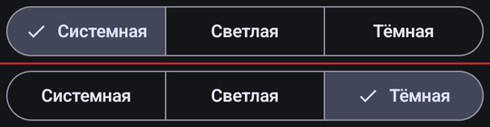
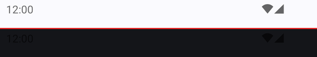
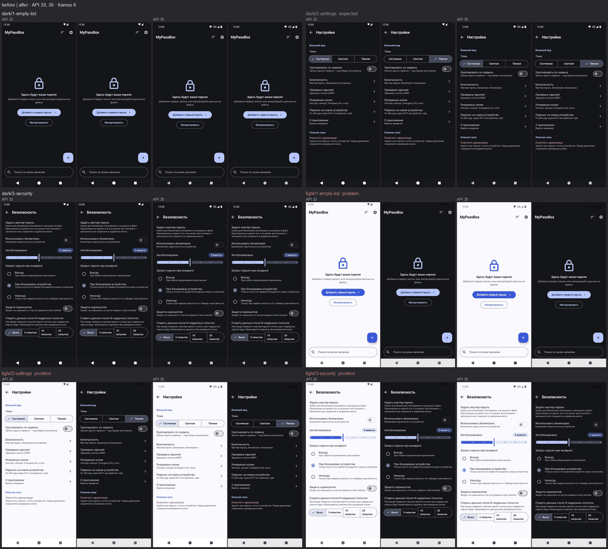

# Пример прогона

[English](example.md) · [README](../README.ru.md)

Это реальный прогон в приложении MyPassBox. В нём сменили тему по умолчанию: была «Системная»,
стала «Тёмная». Агент проверил три экрана на API 33 и 35 при светлой и тёмной системной теме.

## Команды

```bash
adbm new mypassbox-dark-default
adbm install before.apk --as before --api 33,35
adbm run .adbm/flows/theme-default.yaml --api 33,35 --as before --matrix theme=light,dark
adbm install after.apk --as after --api 33,35
adbm run .adbm/flows/theme-default.yaml --api 33,35 --as after --matrix theme=light,dark
adbm diff
adbm board --open
```

Если уровни API заданы в настройках проекта, `--api` можно не писать
(см. [configuration.ru.md](configuration.ru.md)).

## 1. Сборки и сценарий

`adbm install` ставит сборку «до» на все эмуляторы сразу, позже — сборку «после». `adbm run` прогоняет
один Maestro flow на всех API параллельно, в каждой ячейке матрицы `theme=light,dark`.
Кадры ложатся в папку прогона, в контекст агента они не попадают.

## 2. Дифф

`adbm diff` сравнивает пары «до | после» по пикселям и пишет одну строку на пару:

```
api33/dark/2-settings: 2.5% @45,483-1035,582
api35/dark/2-settings: ≈ api33: the same change
api33/light/1-empty-list: 94.4% @0,96-1080,2274 · status bar differs
api35/light/1-empty-list: ≈ api33: the same change
…
pairs 12, changed 8 (4 same as another API), unchanged 4 · diff images: diff/
```

Неизменённые пары дальше никто не смотрит. Значок `≈` значит, что на другом API пара изменилась так же.
Для небольшого изменения дифф вырезает кроп: «до» сверху, «после» снизу. Здесь это переключатель темы:



Статус-бар дифф сравнивает отдельно. На этом кропе видна ошибка: в «после» тёмные часы и иконки на тёмном фоне.



## 3. Вердикт

Субагент `adbm-eyes` смотрит коллаж и кропы по чек-листу задачи. На каждую изменённую пару
он пишет вердикт: EXPECTED — так задумано, PROBLEM — дефект, REVIEW — нужен взгляд человека.
Основной агент получает до 10 строк текста и не открывает ни одной картинки.

Коллаж `00-summary.png` собирает все изменённые пары на одной картинке. Его смотрит субагент, а человеку
он нужен для быстрого взгляда:



## 4. Борд

`adbm board` собирает HTML-страницу: итог, вердикты, пары кадров с процентом изменения,
фильтр по API и режим «changed only».


## Итог

Тёмная тема по умолчанию работает. Но при светлой системной теме часы и иконки статус-бара
стали тёмными на тёмном фоне, а навбар остался светлым. Так на обоих API.
